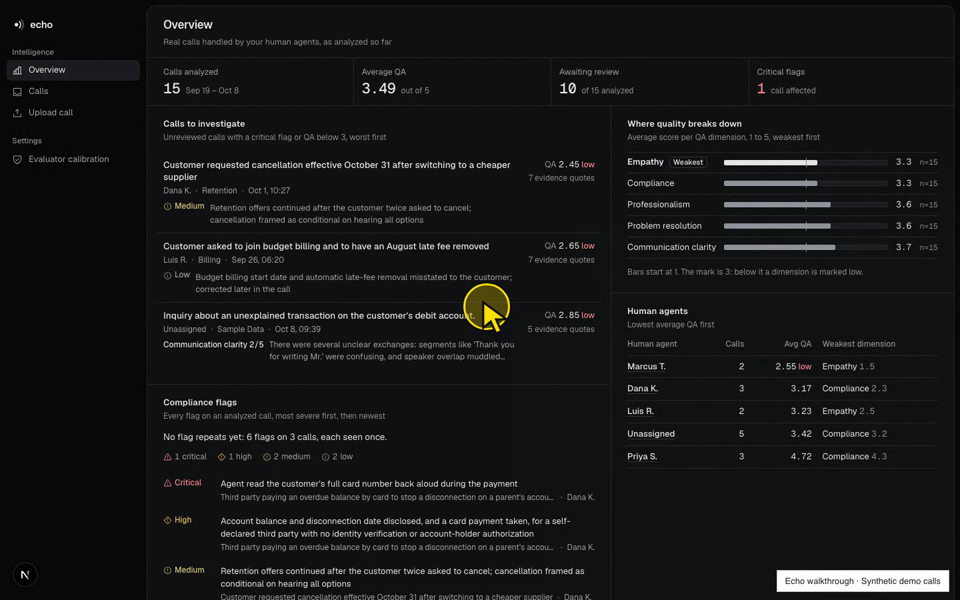

# Call Intelligence

A Gradio application for post-call review: local transcription, speaker labels,
structured summaries, evidence-based QA, compliance findings, and PDF/JSON exports.

## Extended Personal Version

[Echo, the extended personal version](https://github.com/amishaguptaberk/call-center-intelligence)
builds on this capstone with a Next.js dashboard, FastAPI, Postgres, call queues,
recording playback, human review decisions, and evaluator calibration.
That repository is private; reviewers need GitHub access.

[](docs/demo/echo-demo.mp4)

[Watch the included Echo walkthrough](docs/demo/echo-demo.mp4). The recorded
demo uses synthetic calls and is included here for reviewers without access
to the extended repository.

## Quick Start

Requires Python 3.11+ and FFmpeg (macOS: `brew install ffmpeg`; Ubuntu:
`sudo apt-get install ffmpeg`):

```sh
python3.11 -m venv .venv
.venv/bin/python -m pip install -r requirements-dev.txt
cp .env.example .env
# Set OPENAI_API_KEY in .env, or select another configured LLM_PROVIDER.
make run
```

Open [Call Intelligence](http://127.0.0.1:7860). SQLite initializes automatically;
there is no database server to install. Choose one of ten bundled recordings or
upload/record a call. First startup downloads Whisper base; allow several
minutes on CPU. Internet access and provider credentials are needed for analysis.

## Docker

```sh
cp .env.example .env
# Configure the selected provider key in .env.
docker compose up --build
```

Open the same local URL. Stop with `docker compose down`; SQLite records remain
in the named volume. The image includes FFmpeg and bundled samples.

## Hugging Face Spaces

The Docker configuration supports a Hugging Face Space on port 7860. To publish:

```sh
.venv/bin/hf auth login
.venv/bin/python scripts/deploy_space.py --repo-id YOUR_USERNAME/call-center-intelligence --env-file .env
```

Use a write-capable Hugging Face token. The deployment creates a private Space,
uploads only runtime source and sample recordings, and stores the selected
provider key as a Space secret. It never uploads .env, databases, or local reports.
The Space needs no Hugging Face token at runtime with heuristic diarization.
The free CPU deployment's SQLite data is ephemeral across rebuilds/restarts;
Compose's local named volume is separate from hosted storage.

## Reviewer Walkthrough

1. Choose Sample 01, listen, then select Analyze Call.
2. Review the summary, five-dimension QA, evidence, coaching, and transcript.
3. Download PDF and JSON reports for the same call.
4. Open All MP3 History, select a stored call, and reopen its review and exports.
5. Open Observability to inspect outcomes and the recent audit ledger.
6. Try another recording or the microphone; critical findings require review.

## Architecture

```text
Audio -> Intake -> Transcription/cache -> Injection check -> PII redaction
      -> Summary -> QA -> Report or Supervisor review
```

LangGraph coordinates typed state and conditional routing. Faster-Whisper runs
locally. Structured model analysis includes retries. SQLite stores reports,
transcription cache entries, and append-only audit events. Gradio provides
Analyze call, All MP3 History, and Observability. The workflow and speech model
initialize once at startup. The newer product dashboard is linked above.
See [submission notes](SUBMISSION.md) for milestone mapping.

## Verification

See [submission readiness](SUBMISSION_READINESS.md) for the remaining acceptance
checks, packaging steps, and publication requirements.

```sh
make test
make test-integration
make test-all
make lint
.venv/bin/pre-commit run --all-files
```

Tests use temporary SQLite databases and mocked external models; credentials
and Docker are not needed. See [verification results](VERIFICATION.md) for
executed checks and limits.

## Configuration and Deployment

All settings are documented in `.env.example`. Select openai, gemini, or groq
using LLM_PROVIDER and set the corresponding key. LLM_MODEL overrides the
provider default. Heuristic speaker attribution is approximate. For local
acoustic/hybrid attribution, install `requirements-diarization.txt`, accept the
Community-1 model terms, set HF_TOKEN, and select DIARIZATION_BACKEND.
GPU deployment requires compatible CUDA and CTranslate2 libraries; automated
tests do not verify GPU support. CPU is the portable default.

## Privacy and Limitations

Regex redaction covers configured SSN, credit-card, email, and phone formats,
but cannot guarantee anonymization. Redacted transcripts feed downstream model
analysis. Raw transcripts remain in the local cache; this capstone does not
implement automatic cache expiration. Exports use configurable rolling cleanup;
intake audio is removed after each pipeline run. Low-confidence transcripts
are held before model analysis.
Stock SQLite does not provide encryption merely by setting DB_ENCRYPTION_KEY.
There is no authentication. Use consented recordings and trusted local
interfaces. Optional LangSmith tracing is disabled by default. Never commit
.env, credentials, databases, or private recordings.
